<div align="center">

# 🎓 Teacher-Student Curriculum Learning with GRPO

[](https://www.python.org/)
[](https://pytorch.org/)
[](LICENSE)
[](https://github.com)

**A self-play reinforcement learning system where a single language model learns to both generate educational problems (as a Teacher) and solve them (as a Student).**

The model is trained using Group Relative Policy Optimization (GRPO) to create problems at optimal difficulty levels.

```
    ╔═══════════════════════════════════════════════════════╗
    ║                                                       ║
    ║   🧠 Teacher generates problems                       ║
    ║         ⬇️                                              ║
    ║   🎯 Student solves problems                           ║
    ║         ⬇️                                              ║
    ║   📊 Rewards update both                              ║
    ║         ⬇️                                              ║
    ║   🔄 Model improves iteratively                        ║
    ║                                                       ║
    ╚═══════════════════════════════════════════════════════╝
```

</div>

## Architecture Overview

```mermaid
graph TB
    subgraph SelfPlay[Self-Play Training Loop]
        Model[Shared Language Model]
        
        subgraph TeacherPhase[Teacher Phase]
            T1[Generate Curricula<br/>from Seed Task]
            T2[Extract Python Programs]
            T3[Format Check]
        end
        
        subgraph StudentPhase[Student Phase]
            S1[Solve Each Problem<br/>Multiple Attempts]
            S2[Evaluate Solutions]
            S3[Calculate Solved Rate]
        end
        
        subgraph RewardUpdate[Reward Calculation]
            R1[Teacher Reward:<br/>solved_rate × 1-solved_rate]
            R2[Student Reward:<br/>Problem Correctness]
        end
        
        subgraph Training[GRPO Update]
            U1[Update with<br/>Student Experience]
            U2[Update with<br/>Teacher Experience]
        end
    end
    
    Model -->|Teacher Role| T1
    T1 --> T2
    T2 --> T3
    T3 -->|Valid Curricula| S1
    
    Model -->|Student Role| S1
    S1 --> S2
    S2 --> S3
    
    S3 --> R1
    S2 --> R2
    
    R1 & R2 --> U1
    U1 --> U2
    U2 -->|Updated Model| Model
    
    style Model fill:#e1f5ff,stroke:#4a90e2,stroke-width:3px
    style TeacherPhase fill:#fff4e6,stroke:#f39c12
    style StudentPhase fill:#e8f8f5,stroke:#27ae60
    style RewardUpdate fill:#fdeef4,stroke:#e74c3c
    style Training fill:#f4ecf7,stroke:#8e44ad
```

<div align="center">



</div>

## Key Features

### 🎯 Self-Play Learning
- **Single Model, Dual Roles**: One language model learns both to teach and to learn
- **Emergent Curriculum**: Teacher learns to generate problems at optimal difficulty
- **Adaptive Difficulty**: Reward formula `solved_rate × (1 - solved_rate)` encourages problems that are neither too easy nor too hard

### 🔄 Training Pipeline

1. **Teacher Rollout**
   - Model generates multiple problem variations from a seed task
   - Extracts Python programs (curricula) from completions
   - Filters for correctly formatted problems
   
2. **Student Rollout**
   - Same model attempts to solve each generated problem
   - Multiple solution attempts per problem (group-based)
   - Solutions evaluated for correctness

3. **Reward Assignment**
   - **Teacher Reward**: Learnability score based on student success rate
     - Formula: `r_teacher = p × (1 - p)` where `p` is solved rate
     - Maximum reward at 50% success (optimal difficulty)
   - **Student Reward**: Binary correctness of solution

4. **GRPO Updates**
   - Two sequential updates using shared model
   - Student experience → Teacher experience
   - Both regularized with KL divergence from reference policy

## Installation

```bash
pip install -r requirements.txt
```

## Project Structure

```
teacher/
├── teacher_torch/           # Core training modules
│   ├── train_teacher_student.py  # Main training loop
│   ├── experience.py        # Experience data structures
│   ├── rollout.py           # Sampling and rollout logic
│   ├── policy_gradient.py  # GRPO optimization
│   └── loss.py              # Loss functions
├── curriculum/              # Task definitions
│   ├── prompt_template.py  # Teacher/Student prompts
│   └── tasks.py             # Problem specifications
├── environment/             # Reward functions
│   └── reward.py            # Evaluation logic
└── scripts/                 # Training scripts
    ├── train.py
    └── test_*.py            # Unit tests
```

## Core Components

### Experience Types

- **`TeacherExperience`**: Single teacher rollout containing generated curricula
  - `completions`: Raw model outputs
  - `curriculums`: Extracted Python programs
  - `update_teacher_rewards()`: Updates rewards based on student performance
  
- **`StudentExperience`**: Student attempt on a single problem
  - `source_curriculum`: Which problem it's solving
  - `solved_rate`: Success rate property

- **`StudentExperienceBuffer`**: Collection of student experiences
  - `get_solved_rate_by_curriculum()`: Maps curricula to success rates

### Reward Functions

Teacher reward encourages optimal difficulty:
```
r_teacher = solved_rate × (1 - solved_rate)
```

Student reward is based on solution correctness:
```
r_student = 1.0 if correct else 0.0
```

## Configuration

Key hyperparameters in `GRPOConfig`:

| Parameter | Default | Description |
|-----------|---------|-------------|
| `teacher_group_size` | 8 | Problems generated per rollout |
| `student_group_size` | 16 | Solution attempts per problem |
| `learning_rate` | 1e-5 | AdamW learning rate |
| `clip_eps` | 0.2 | PPO clipping parameter |
| `kl_beta` | 0.04 | KL regularization strength |
| `normalize_advantages` | True | Advantage normalization |
| `solved_threshold` | 1.0 | Threshold for "solved" |
| `max_new_tokens` | 512 | Maximum generation length |
| `temperature` | 0.7 | Sampling temperature |

## Training Metrics

The system tracks metrics at each training step:

**Teacher Metrics**
- Mean reward, standard deviation
- Entropy of generation distribution
- Mean learnability score

**Student Metrics**  
- Mean reward, standard deviation
- Solved rate across problems
- Entropy of generation distribution

**Training Metrics**
- Loss (policy + KL penalty)
- KL divergence from reference
- Policy loss component
- Gradient norm

## Research Background

This implementation is based on curriculum learning and self-play principles:

1. **Curriculum Learning**: Gradually increasing task difficulty improves learning efficiency
2. **Self-Play**: Agent generates its own training data through interaction with itself
3. **GRPO**: Group Relative Policy Optimization enables stable RL fine-tuning of language models
4. **Learnability**: Optimal difficulty is measured by the rate at which students can solve problems

The key insight is that the teacher should generate problems that are challenging but learnable - captured by maximizing `p(1-p)` where `p` is the student's success rate.

## Citation

```bibtex
@software{teacher_student_grpo,
  title={Teacher-Student Curriculum Learning with GRPO},
  year={2024},
  url={https://github.com/yourusername/teacher}
}
```

## License

MIT License

## Contributing

Contributions welcome! Please open an issue or pull request.
